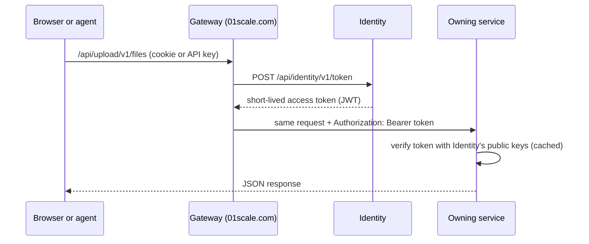

# API design — 01scale

01scale is built **API first** and **agents first**, as a set of independent services behind one gateway (see `ARCHITECTURE.md`). This file holds the rules every service's API follows and an index of all 115 designed endpoints, grouped by the service that owns them. The full contract for each endpoint (request, response, errors) lives in its story in `docs/epics/`, next to the database design for that story.

**Status: design only.** No endpoint here is built until its story is picked up.

## What the two principles mean

- **API first.** Each service's API is its product; UIs and apps are clients of it. An endpoint is designed in its story before any code is written, every capability has an endpoint, and nothing reads a service's database except that service.
- **Agents first.** Anything a person can do in the UI, an AI agent can do through the API with the user's permission. That needs four things: authentication without a browser (API keys), a machine-readable contract (OpenAPI), tools an agent can call directly (an MCP server per service and one combined at the gateway), and responses an agent can act on (stable error codes, idempotent writes, explicit `next_action` fields).

## How a request travels

Services never see cookies or API keys, and they do not call Identity on each request: they verify the signed token themselves.

## Conventions

| Topic | Rule |
|---|---|
| Address | `01scale.com/api/{service}/v{N}/…`. The gateway routes by the service name in the path. |
| Versioning | Each service versions on its own. Additive changes stay in the current version; a breaking change ships as the next version while the old one keeps working until its consumers have moved. |
| Format | JSON in and out, `snake_case` field names, ISO 8601 UTC timestamps, money as integer minor units plus an ISO 4217 `currency`. |
| IDs | UUIDv7 strings. A record owned by another service is referenced by its ID only. |
| Contract | OpenAPI 3.1 per service at `GET /api/{service}/v1/openapi.json`, generated from the zod schemas the handlers validate with; combined at `GET /api/openapi.json`. |
| Authentication | Browsers send a session cookie, agents send `Authorization: Bearer <API key>`. The gateway exchanges either for a 5-minute access token (JWT) that every service verifies. |
| Service-to-service | A service or app calling another forwards the user's access token, so ownership checks still apply. Calls made without a user (webhook handlers, background work) use a service token with the `service` role. |
| Authorization | A user sees only their own resources. Other users' resources return `404`, not `403`, so IDs cannot be probed. API keys are limited to their scopes. |
| Errors | RFC 9457 `application/problem+json`: `{type, title, status, detail, code, request_id, errors[]}`. `code` is stable and machine-readable. |
| Lists | Cursor pagination: `cursor`, `limit` (max 100) → `{data, next_cursor}`. |
| Writes | `POST` endpoints that create things accept `Idempotency-Key`. State changes that can be retried are idempotent by design. |
| Long-running work | Return `202` with a job resource; the client polls a `GET` that sends `Retry-After`. |
| Events | A service announces changes as signed events (`<service>.<resource>.<what happened>`) delivered by HTTP to subscribed apps, written with the change in one transaction and retried. Receivers are idempotent on `event_id`. |
| Resilience | Every call to another service has a timeout and a safe retry. A dependency being down gives a `503` problem response. |
| Files | Never proxied through an API. Uploads and downloads use short-lived presigned S3 URLs issued by Upload. |
| Webhooks in | Signature verified, idempotent on the provider's event ID. |
| CSRF | The gateway checks the `Origin` header on cookie-authenticated writes. API-key requests are exempt because they carry no ambient credentials. |
| Rate limits | Applied at the gateway: `429` with `Retry-After`. Auth endpoints answer the same way whether or not an account exists. |
| Tracing | `X-Request-Id` is set by the gateway and passed on every hop. |
| Audit | Each service records its own auth, review, payment and delivery events and every API-key call, with the actor type. |

## Access levels

| Label | Meaning |
|---|---|
| Public | No credentials needed. |
| Signed in | A user's session or API key (as an access token). Some account-security endpoints accept a session only; the story says so. |
| Admin | Signed in with the `is_admin` claim. Others get `404`. |
| Service | Called by an app's server or another system with a service token or a verified signature (Stripe, the SMS provider, the gateway). Never callable from a browser. |

## Platform services and apps

- **Services are app-agnostic.** Upload knows about files, not invoices. Payment knows about orders with an opaque `reference`, not documents. That is what lets a second app reuse them.
- **Apps hold the process.** DocFlow's own API under `/api/docflow/v1` owns the invoice process: which file, which job, which review task and which order belong together, and what the next step is. It calls the services in a fixed order.
- **Prices and entitlements are app decisions.** Only an app's server can create a Payment order or send a Delivery message (Service access), so a browser can never set an amount.
- **Services acting for a user** (decision on #24): a step with no person present (for example DocFlow after an extraction finishes) uses a delegated token from Identity: the user's token, marked with the acting service in `act`. Every service keeps one ownership rule, and audit records both.
- **Every call goes through the gateway** (decision on #21): services and apps call each other at `01scale.com/api/{service}/v1/…`, like any client.

## Agent access

- **API keys** (`MVP1-E0-06`): created by a signed-in user in Identity, shown once, stored as a hash, scoped per service, revocable.
- **MCP**: each service exposes its operations as tools at `POST /api/{service}/mcp`; the gateway offers all of them at `POST /api/mcp`, namespaced by service.
- **Humans stay in the loop where it matters**: an agent gets a `checkout_url` for the user to pay; it cannot manage keys, change the password or delete the account.
- **Later**: OAuth for agent identity, so a third-party agent acts under its own identity with delegated consent.

## Endpoint index

### Every service (platform)

Endpoints every service provides, from the shared service template.

| Method | Path | Access | What it does | Story |
|---|---|---|---|---|
| `GET` | `/api/{service}/v1/audit-events` | Signed in | List my audit events in that service (admins: all users). | `MVP1-E0-02` |
| `GET` | `/api/{service}/v1/health` | Public | Liveness check for that service. | `MVP1-E0-05` |
| `GET` | `/api/{service}/v1/openapi.json` | Public | That service's OpenAPI 3.1 contract. | `MVP1-E0-05` |
| `POST` | `/api/{service}/mcp` | Signed in | That service's MCP server: its operations exposed as tools for AI agents. | `MVP1-E0-06` |

### Gateway (platform)

The single front door at 01scale.com: routes each request to the service that owns it.

| Method | Path | Access | What it does | Story |
|---|---|---|---|---|
| `GET` | `/api/health` | Public | Health of the platform: the gateway and each service behind it. | `MVP1-E0-08` |
| `GET` | `/api/openapi.json` | Public | One combined OpenAPI document for every service. | `MVP1-E0-08` |
| `POST` | `/api/mcp` | Signed in | One combined MCP server: every service's tools, namespaced by service. | `MVP1-E0-08` |

### Identity (service)

Sign-in, sessions, accounts, API keys and the tokens every other service trusts.

| Method | Path | Access | What it does | Story |
|---|---|---|---|---|
| `GET` | `/api/identity/v1/api-keys` | Signed in | List my API keys (name, prefix, scopes, last used). Never returns the secret. | `MVP1-E0-06` |
| `POST` | `/api/identity/v1/api-keys` | Signed in | Create an API key for an agent or script. The secret is shown once. | `MVP1-E0-06` |
| `DELETE` | `/api/identity/v1/api-keys/{keyId}` | Signed in | Revoke an API key immediately. | `MVP1-E0-06` |
| `GET` | `/api/identity/v1/auth/login` | Public | Start sign-in or sign-up: redirects to the identity provider (OIDC + PKCE). | `MVP1-E1-02` |
| `GET` | `/api/identity/v1/auth/callback` | Public | OIDC redirect target: exchanges the code and creates the session. | `MVP1-E1-03` |
| `POST` | `/api/identity/v1/auth/logout` | Signed in | End the current session and sign out of the identity provider. | `MVP1-E1-03` |
| `GET` | `/api/identity/v1/session` | Signed in | Who am I: the current session and user, or 401. | `MVP1-E1-03` |
| `POST` | `/api/identity/v1/token` | Service | Exchange a session cookie or API key for a short-lived access token (called by the gateway). | `MVP1-E1-03` |
| `POST` | `/api/identity/v1/token` (client credentials, token exchange) | Service | A service signs in as itself; a service allowed to act for users gets a 5-minute delegated token for one user (`act` claim). | `MVP1-E1-03` |
| `GET` | `/api/identity/v1/users/{userId}` | Service | A user's verified email, for services that write to them (Delivery). | `MVP1-E7-01` |
| `GET` | `/api/identity/v1/jwks` | Public | The public keys services use to verify access tokens. | `MVP1-E1-03` |
| `GET` | `/api/identity/v1/me` | Signed in | My account: email and joined date. | `MVP1-E1-05` |
| `POST` | `/api/identity/v1/me/password-change` | Signed in | Start a password change through the identity provider. | `MVP1-E1-05` |
| `DELETE` | `/api/identity/v1/me` | Signed in | Delete my account. Every service then deletes that user's data. | `MVP1-E1-05` |
| `POST` | `/api/identity/v1/auth/magic-links` | Public | Request a sign-in email. Always answers the same way. | `MVP2-E8-02` |
| `POST` | `/api/identity/v1/auth/magic-links/confirm` | Public | Exchange a magic-link token for a session (deliberate POST). | `MVP2-E8-02` |
| `POST` | `/api/identity/v1/auth/email-codes/verify` | Public | Sign in with the 6-digit code from the same email. | `MVP2-E8-03` |
| `POST` | `/api/identity/v1/passkeys/registration-options` | Signed in | WebAuthn options to register a new passkey. | `MVP2-E8-04` |
| `POST` | `/api/identity/v1/passkeys` | Signed in | Verify the registration and save the passkey. | `MVP2-E8-04` |
| `GET` | `/api/identity/v1/passkeys` | Signed in | List my passkeys. | `MVP2-E8-04` |
| `PATCH` | `/api/identity/v1/passkeys/{passkeyId}` | Signed in | Rename a passkey. | `MVP2-E8-04` |
| `DELETE` | `/api/identity/v1/passkeys/{passkeyId}` | Signed in | Remove a passkey (needs recent re-authentication). | `MVP2-E8-04` |
| `POST` | `/api/identity/v1/auth/passkeys/authentication-options` | Public | WebAuthn options to sign in with a passkey (no email needed). | `MVP2-E8-04` |
| `POST` | `/api/identity/v1/auth/passkeys/verify` | Public | Verify a passkey assertion and create a session. | `MVP2-E8-04` |
| `POST` | `/api/identity/v1/recovery-codes` | Signed in | Regenerate recovery codes; the old set stops working. | `MVP2-E8-05` |
| `POST` | `/api/identity/v1/auth/recovery-codes/verify` | Public | Sign in with a single-use recovery code. | `MVP2-E8-05` |
| `GET` | `/api/identity/v1/sessions` | Signed in | List my active sessions with device and last active time. | `MVP2-E8-06` |
| `DELETE` | `/api/identity/v1/sessions/{sessionId}` | Signed in | Revoke one session. | `MVP2-E8-06` |
| `DELETE` | `/api/identity/v1/sessions` | Signed in | Sign out everywhere else. | `MVP2-E8-06` |
| `POST` | `/api/identity/v1/auth/reauthentication` | Signed in | Start re-authentication for a sensitive action. | `MVP2-E8-07` |
| `POST` | `/api/identity/v1/auth/reauthentication/verify` | Signed in | Finish re-authentication; valid for 5 minutes. | `MVP2-E8-07` |
| `POST` | `/api/identity/v1/me/email-change` | Signed in | Ask to change my email (confirmation goes to the new address). | `MVP2-E8-07` |
| `POST` | `/api/identity/v1/me/email-change/confirm` | Signed in | Confirm the new email address. | `MVP2-E8-07` |
| `GET` | `/api/identity/v1/admin/migration-report` | Admin | Users migrated from Cognito vs not yet migrated. | `MVP2-E8-08` |
| `POST` | `/api/identity/v1/me/phone` | Signed in | Add a phone number; sends a 6-digit code. | `MVP2-E14-02` |
| `POST` | `/api/identity/v1/me/phone/verify` | Signed in | Verify the phone number. | `MVP2-E14-02` |
| `DELETE` | `/api/identity/v1/me/phone` | Signed in | Remove my phone number. | `MVP2-E14-02` |

### Upload (service)

Secure file intake and storage with short-lived links.

| Method | Path | Access | What it does | Story |
|---|---|---|---|---|
| `POST` | `/api/upload/v1/files` | Signed in | Create a file record and get a presigned upload URL. | `MVP1-E2-02` |
| `GET` | `/api/upload/v1/files/{fileId}` | Signed in | Get one file's details and status. | `MVP1-E2-02` |
| `DELETE` | `/api/upload/v1/files/{fileId}` | Signed in | Delete a file and its stored object. | `MVP1-E2-02` |
| `POST` | `/api/upload/v1/files/{fileId}/complete` | Signed in | Confirm the upload; the service verifies the stored file. | `MVP1-E2-03` |
| `GET` | `/api/upload/v1/files/{fileId}/download-url` | Signed in | A short-lived link to read the file. | `MVP1-E2-03` |
| `GET` | `/api/upload/v1/files` | Signed in | List my files. | `MVP1-E2-05` |

### LLM Extraction (service)

Turns a file into structured fields with confidence and evidence.

| Method | Path | Access | What it does | Story |
|---|---|---|---|---|
| `POST` | `/api/extraction/v1/jobs` | Signed in | Start an extraction job for a file. Safe to call twice. A person's own jobs count toward a free daily quota (`MVP1-E3-09`). | `MVP1-E3-01` |
| `GET` | `/api/extraction/v1/jobs/{jobId}` | Signed in | Extraction job status, for polling. | `MVP1-E3-01` |
| `GET` | `/api/extraction/v1/jobs/{jobId}/fields` | Signed in | The extracted fields with value, confidence and evidence; only the flagged fields while a job is held for an app (`MVP1-E3-08`). | `MVP1-E3-02` |
| `POST` | `/api/extraction/v1/jobs/{jobId}/release` | Service | The app holding a job's results releases them to the owner (`hold: true` on `POST /jobs`). | `MVP1-E3-08` |
| `GET` | `/api/extraction/v1/usage` | Signed in | Today's free jobs a person started themselves, out of their daily quota. | `MVP1-E3-09` |
| `POST` | `/api/extraction/v1/validations` | Signed in | Run the rule checks for a schema on a set of values. | `MVP1-E3-03` |
| `GET` | `/api/extraction/v1/admin/jobs` | Admin | Last 100 jobs with tokens, cost, duration and failure rate. | `MVP1-E3-05` |
| `POST` | `/api/extraction/v1/job-groups` | Signed in | Run several extraction jobs as one group with a concurrency limit. | `MVP2-E9-02` |
| `GET` | `/api/extraction/v1/job-groups/{groupId}` | Signed in | Group status with each job's current step. | `MVP2-E9-02` |
| `GET` | `/api/extraction/v1/jobs/{jobId}/enrichment` | Signed in | Web-sourced vendor metadata with citations for a job. | `MVP2-E11-01` |

### Human Review (service)

A person checks the fields the system is unsure about.

| Method | Path | Access | What it does | Story |
|---|---|---|---|---|
| `POST` | `/api/review/v1/tasks` | Signed in | Create a review task from a set of fields. | `MVP1-E4-01` |
| `GET` | `/api/review/v1/tasks/{taskId}` | Signed in | The review queue: flagged fields first, lowest confidence first. | `MVP1-E4-01` |
| `PATCH` | `/api/review/v1/tasks/{taskId}/fields/{fieldId}` | Signed in | Accept, edit or mark a field as not on the document. | `MVP1-E4-02` |
| `POST` | `/api/review/v1/tasks/{taskId}/complete` | Signed in | Complete the task once every flagged field is resolved. | `MVP1-E4-03` |
| `POST` | `/api/review/v1/tasks/{taskId}/release` | Service | The app holding a task's unflagged fields releases them to the owner (`hold: true` on `POST /tasks`). | `MVP1-E4-06` |
| `GET` | `/api/review/v1/admin/eval-candidates` | Admin | Human corrections waiting for approval as eval cases. | `MVP1-E4-04` |
| `GET` | `/api/review/v1/admin/accuracy` | Admin | How often people correct each field: counts and rates only, never values (decision on #41). | `MVP1-E4-04` |
| `GET` | `/api/review/v1/admin/quality` | Admin | Judge vs human: agreement, confusion matrix, weakest fields (30 days). | `MVP2-E10-03` |
| `POST` | `/api/review/v1/admin/quality/candidates` | Admin | Add judge/human disagreements to eval candidates inside Review's database; a count only, nothing leaves the service (#41). | `MVP2-E10-03` |
| `GET` | `/api/review/v1/tasks/{taskId}/chat/messages` | Signed in | The correction chat history for a task. | `MVP2-E11-03` |
| `POST` | `/api/review/v1/tasks/{taskId}/chat/messages` | Signed in | Ask the correction agent to fix data in plain language. | `MVP2-E11-03` |
| `POST` | `/api/review/v1/tasks/{taskId}/proposals/{proposalId}/apply` | Signed in | Apply a proposed change. | `MVP2-E11-03` |
| `POST` | `/api/review/v1/tasks/{taskId}/proposals/{proposalId}/reject` | Signed in | Reject a proposed change. | `MVP2-E11-03` |
| `POST` | `/api/review/v1/tasks/{taskId}/proposals/{proposalId}/undo` | Signed in | Undo an applied change. | `MVP2-E11-03` |

### Payment (service)

Orders, checkout and payment status.

| Method | Path | Access | What it does | Story |
|---|---|---|---|---|
| `POST` | `/api/payment/v1/orders` | Service | Create an order and a Stripe Checkout session. Called by an app's server, never the browser. | `MVP1-E6-01` |
| `POST` | `/api/payment/v1/webhooks/stripe` | Service | Stripe webhook: marks orders paid, expired or failed. | `MVP1-E6-02` |
| `GET` | `/api/payment/v1/orders` | Signed in | List my orders. | `MVP1-E6-03` |
| `GET` | `/api/payment/v1/orders/{orderId}` | Signed in | Get one order, for payment and success pages to poll. | `MVP1-E6-03` |
| `POST` | `/api/payment/v1/payment-methods/setup-intents` | Signed in | Start saving a card (Stripe SetupIntent). | `MVP2-E13-02` |
| `GET` | `/api/payment/v1/payment-methods` | Signed in | List my saved cards. | `MVP2-E13-03` |
| `PATCH` | `/api/payment/v1/payment-methods/{paymentMethodId}` | Signed in | Make a card the default. | `MVP2-E13-03` |
| `DELETE` | `/api/payment/v1/payment-methods/{paymentMethodId}` | Signed in | Remove a saved card (needs recent re-authentication). | `MVP2-E13-03` |
| `POST` | `/api/payment/v1/payments` | Service | Charge a saved card. Called by an app's server, which sets the amount. | `MVP2-E13-04` |
| `GET` | `/api/payment/v1/payments` | Signed in | Payment history, newest first. | `MVP2-E13-05` |

### Delivery (service)

Email and, later, SMS and push notifications.

| Method | Path | Access | What it does | Story |
|---|---|---|---|---|
| `POST` | `/api/delivery/v1/messages` | Service | Send a templated email to a user. Called by an app's server. | `MVP1-E7-03` |
| `GET` | `/api/delivery/v1/messages` | Signed in | My messages and their delivery status. | `MVP1-E7-03` |
| `GET` | `/api/delivery/v1/notification-preferences` | Signed in | My notification settings per channel and event. | `MVP2-E14-01` |
| `PUT` | `/api/delivery/v1/notification-preferences` | Signed in | Replace my notification settings. | `MVP2-E14-01` |
| `POST` | `/api/delivery/v1/webhooks/sms` | Service | Inbound SMS webhook: handles STOP opt-outs. | `MVP2-E14-02` |
| `GET` | `/api/delivery/v1/push/public-key` | Public | The VAPID public key for web push. | `MVP2-E14-03` |
| `POST` | `/api/delivery/v1/push-subscriptions` | Signed in | Register this device for push notifications. | `MVP2-E14-03` |
| `DELETE` | `/api/delivery/v1/push-subscriptions/{subscriptionId}` | Signed in | Remove a device. | `MVP2-E14-03` |
| `POST` | `/api/delivery/v1/notifications` | Service | Notify a user about an event on every channel they have enabled. Called by an app's server. | `MVP2-E14-04` |
| `GET` | `/api/delivery/v1/notifications` | Signed in | My notification log: each attempt per channel. | `MVP2-E14-04` |

### DocFlow (app)

The first app: the invoice process assembled from the platform services.

| Method | Path | Access | What it does | Story |
|---|---|---|---|---|
| `POST` | `/api/docflow/v1/webhooks/{service}` | Service | Receives signed events from platform services and moves the process forward. | `MVP1-E0-09` |
| `GET` | `/api/docflow/v1/stats` | Signed in | My DocFlow totals for the account page. | `MVP1-E1-05` |
| `POST` | `/api/docflow/v1/documents` | Signed in | Start the DocFlow process for one invoice: creates the document and its upload. | `MVP1-E2-02` |
| `POST` | `/api/docflow/v1/documents/{documentId}/upload-complete` | Signed in | Confirm the upload and start extraction. | `MVP1-E2-03` |
| `GET` | `/api/docflow/v1/documents` | Signed in | List my DocFlow documents with status and the next action. | `MVP1-E2-05` |
| `GET` | `/api/docflow/v1/documents/{documentId}` | Signed in | Get one DocFlow document and the IDs of its parts in each service. | `MVP1-E2-05` |
| `POST` | `/api/docflow/v1/documents/{documentId}/retry-extraction` | Signed in | Retry a failed extraction for a document. | `MVP1-E3-01` |
| `POST` | `/api/docflow/v1/documents/{documentId}/complete-review` | Signed in | Finish review for a document: re-checks the corrected data and completes the review. | `MVP1-E4-03` |
| `GET` | `/api/docflow/v1/documents/{documentId}/outputs` | Signed in | Results status: whether download is unlocked and whether the current values pass every check. | `MVP1-E5-01` |
| `GET` | `/api/docflow/v1/documents/{documentId}/outputs/{format}/preview` | Signed in | Preview the JSON or CSV on screen before paying. | `MVP1-E5-01` |
| `GET` | `/api/docflow/v1/documents/{documentId}/outputs/{format}/download` | Signed in | Download an output, built from Review's latest values. Locked until the order is paid. | `MVP1-E5-03` |
| `POST` | `/api/docflow/v1/documents/{documentId}/checkout` | Signed in | Start payment for a document. | `MVP1-E6-01` |
| `POST` | `/api/docflow/v1/batches` | Signed in | Create a batch of up to 10 documents; each file is checked on its own. | `MVP2-E9-01` |
| `POST` | `/api/docflow/v1/batches/{batchId}/process` | Signed in | Start extraction for the batch once the uploads are confirmed. | `MVP2-E9-01` |
| `GET` | `/api/docflow/v1/batches` | Signed in | List my batches. | `MVP2-E9-03` |
| `GET` | `/api/docflow/v1/batches/{batchId}` | Signed in | Batch status with each document's step and status. | `MVP2-E9-03` |
| `GET` | `/api/docflow/v1/batches/{batchId}/review` | Signed in | Review state across a batch: flagged fields left per document. | `MVP2-E12-01` |
| `PATCH` | `/api/docflow/v1/batches/{batchId}/documents/{documentId}` | Signed in | Leave a document out of the batch (or put it back). | `MVP2-E12-01` |
| `POST` | `/api/docflow/v1/batches/{batchId}/complete-review` | Signed in | Complete the batch review and build the batch outputs. | `MVP2-E12-01` |
| `GET` | `/api/docflow/v1/batches/{batchId}/outputs` | Signed in | The outputs available for a batch. | `MVP2-E12-02` |
| `GET` | `/api/docflow/v1/batches/{batchId}/outputs/{format}/preview` | Signed in | Preview the combined JSON or CSV. | `MVP2-E12-02` |
| `GET` | `/api/docflow/v1/batches/{batchId}/outputs/{format}/download` | Signed in | Download batch.json, batch.csv or batch.zip. | `MVP2-E12-02` |
| `POST` | `/api/docflow/v1/batches/{batchId}/pay` | Signed in | Pay for a batch with my default card in one tap. | `MVP2-E13-04` |
