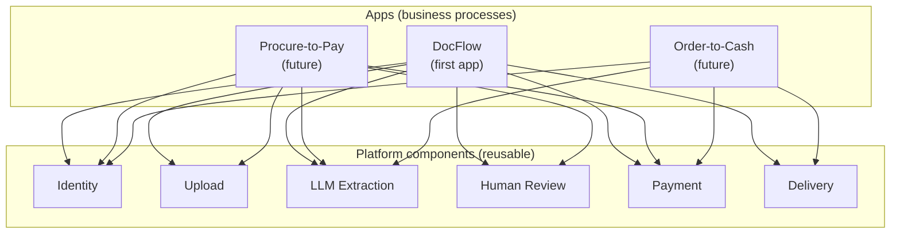
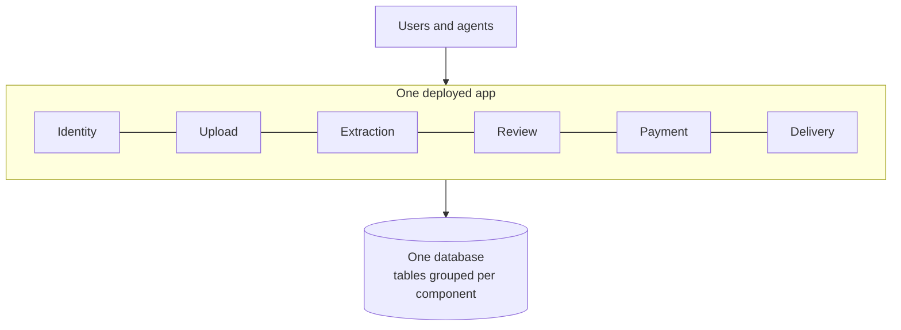
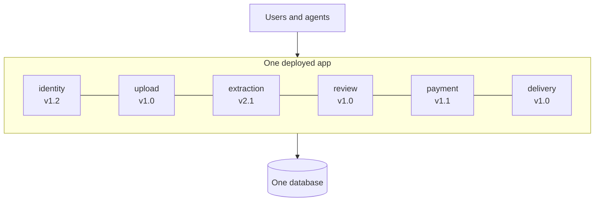
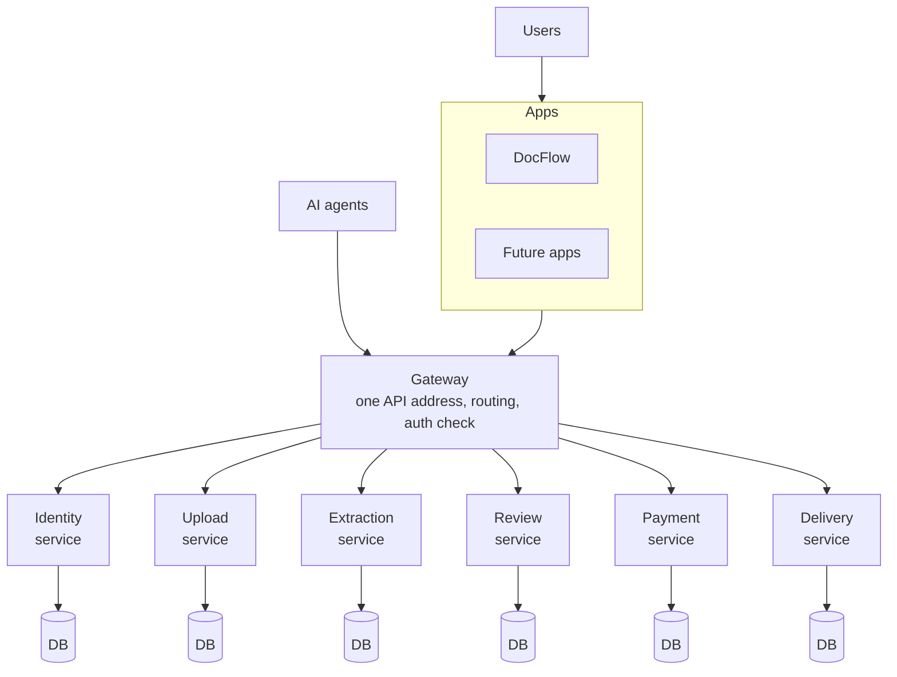
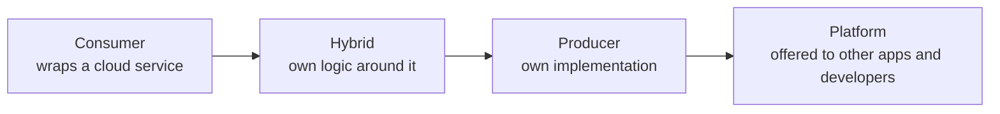
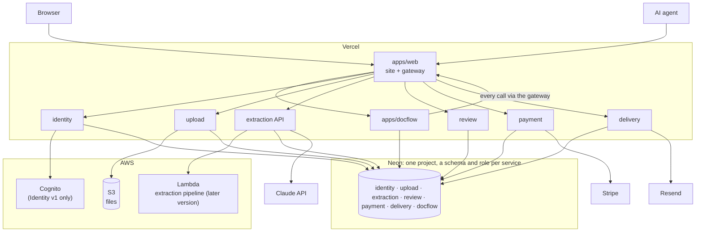
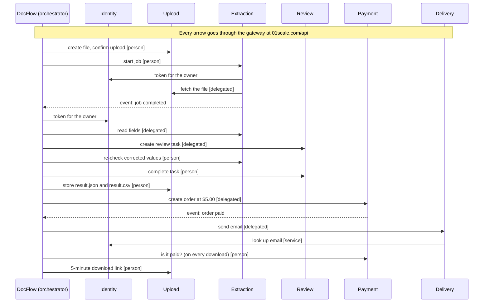
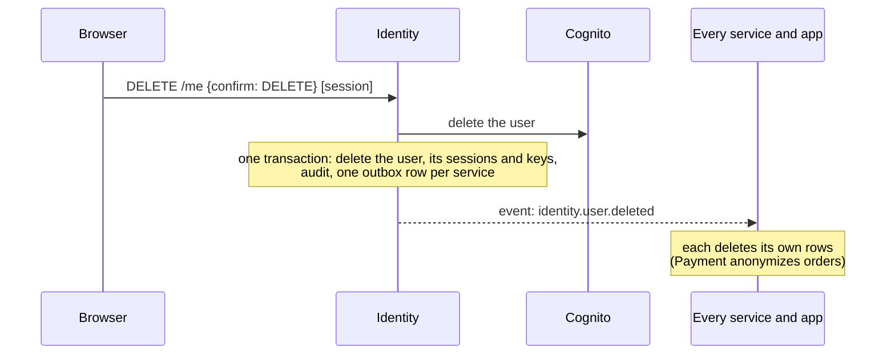

# Architecture — 01scale platform

| | |
|---|---|
| Owner | Nikhil Shrivastava |
| Status | Decided by me: distributed services (Option 3). The supporting decisions are in §10. |
| Related | `API-DESIGN.md`, `DATABASE-DESIGN.md`, `docs/prd/`, `docs/epics/` |

## 1. Summary

01scale is a set of **platform components** (identity, upload, extraction, review, payment, delivery). Each is released, demoed and marketed on its own, with a UI, an API and MCP tools for AI agents. **Apps** are built by combining components. DocFlow is the first app; Procure-to-Pay and Order-to-Cash are examples of later ones.

I compared three architectures and chose **distributed services**: each component is its own service with its own data, contract and release cycle. The reasons are product reasons (reuse across apps, independent evolution, independent release), not scale. §6 explains the choice and §7 states the cost I accepted.

## 2. What I am building



Two layers:

- **Platform components** do one job each and know nothing about the apps that use them.
- **Apps** are thin. An app is a business process: it calls components in an order that makes sense for that process. Procure-to-Pay would reuse Extraction to read supplier invoices; Order-to-Cash would reuse it to read purchase orders and remittances.

A drag-and-drop builder for assembling apps visually is future scope. Nothing here depends on it, and nothing here blocks it.

## 3. Requirements that drive the architecture

| # | Requirement | What it means in practice |
|---|---|---|
| R1 | **Reusable by many apps** | A component serves DocFlow today and other apps later, without being copied or forked. |
| R2 | **Each component evolves through versions, from consumer to producer** | It starts by wrapping an external cloud service and grows into providing that capability itself (§8). Apps must not break as it evolves. |
| R3 | **Independently releasable and marketable** | Each component ships on its own schedule with its own version, demo page, API reference and MCP tools. |
| R4 | **Usable by people, code and agents** | Every component has a UI, an API and MCP tools over the same operations. |
| R5 | **Different technology per component** | Extraction moves to Python and LangGraph on AWS Lambda; the rest is TypeScript. |
| R6 | **Isolation of sensitive components** | Identity and Payment hold the riskiest data and should be walled off from everything else. |
| R7 | **Demonstrates platform product leadership** | The portfolio should show how a real multi-product platform is structured and operated. |

Not a driver: traffic or team size. This is a one-person project with low traffic.

## 4. The three options

### Option 1 — One app with strict boundaries (modular monolith)

One application and one database. Each component is a folder with its own tables and a small public interface. An automated check fails any change where one component reaches into another's internals.



| Pros | Cons |
|---|---|
| Fastest route to a working DocFlow | One deployment: components cannot be released separately |
| Lowest cost: one hosting project, one database | One runtime: a Python component does not fit |
| Simple data consistency: one transaction can span components | A failure or bad deploy in one component affects all |
| One log, easy debugging | Two apps cannot run different versions of the same component |
| Boundaries can still be enforced by automated checks | Independence is a rule the team keeps, not a physical fact |

### Option 2 — Separate packages (one deployment)

Each component is its own versioned package inside the repository, with declared exports. The app installs the packages and is still deployed as one unit.



| Pros | Cons |
|---|---|
| Boundaries enforced by tooling: only exported items are reachable | Extra build and versioning work on every change |
| Each component has its own version and changelog | Still one deployment and one runtime |
| A package could be published for other developers to install | A failure in one component still affects all |
| Easy to lift a package into its own service later | A consumer gets a new version only by redeploying, so components are not truly released on their own |

### Option 3 — Separate services (distributed)

Each component is its own deployed service with its own database and its own published contract. Apps and agents reach the services through one gateway. Services never read each other's data.



| Pros | Cons |
|---|---|
| Each component is released, versioned and rolled back on its own | Slowest route to a working DocFlow |
| Many apps can use the same component, even on different versions | More to run: several deployments, databases and pipelines |
| A component can be rebuilt inside (Cognito → own identity) without consumers changing | No shared transaction: needs idempotency, retries and reconciliation |
| Each component can use the technology that fits it | A request crosses services: needs tracing to debug |
| A failure is contained to one component, if callers handle it | Network calls add latency and new failure modes |
| Sensitive components are isolated with their own data and access | Moving a boundary later is expensive, so boundaries must be right early |

## 5. Comparison

| | Option 1 | Option 2 | Option 3 |
|---|---|---|---|
| Common name | Modular monolith | Modular monolith with packages | Microservices |
| Deployments | 1 | 1 | 1 per component |
| Databases | 1 | 1 | 1 per component |
| Independent release (R3) | No | Version only | Yes |
| Reuse by separate apps (R1) | By sharing one app's code | By installing packages | By calling a service |
| Evolve without breaking apps (R2) | Possible, but all consumers move together | Possible, per redeploy | Yes, old and new versions can run side by side |
| Mixed technology (R5) | No | No | Yes |
| Isolation (R6) | Logical | Logical | Physical |
| Cost and effort | Lowest | Low to medium | Highest |
| Time to first working app | Shortest | Short | Longest |

## 6. Decision: Option 3, and why

### The reasoning

The question I asked myself was: **is 01scale one app, or a platform that many apps consume?**

If it were one app (DocFlow only), I would have chosen Option 1, and most experienced architects would say the same. But my goal is a platform:

1. **Components are products, apps are customers (R1, R3).** Identity or Extraction must stand alone: its own release, its own demo, its own documentation, its own version history. When Procure-to-Pay arrives, it should adopt Extraction by calling it, not by being built inside DocFlow's codebase. A service with a published contract is the natural unit for that.

2. **Each component has a long evolution ahead (R2).** Identity goes from wrapping Cognito to being an identity provider. Extraction goes from one model call to an orchestrated, guarded, cost-routed, judged pipeline. Across all of that, the contract seen by apps stays stable and the inside is replaced. A service boundary makes the inside invisible by construction, and lets version 1 and version 2 run at the same time so each app can move when it is ready.

3. **The components do not share one technology (R5).** Extraction becomes Python on AWS Lambda. That is a separate service no matter what the rest looks like, so the question becomes whether it is the exception or the pattern. Making it the pattern keeps one consistent way of building, securing and observing every component.

4. **Identity and Payment deserve hard walls (R6).** They hold credentials, sessions and payment records. Their own database and their own access rules reduce what any other component's bug can expose.

5. **It shows the work this portfolio is meant to show (R7).** Platform product leadership is largely about contracts between teams, versioning, backward compatibility, service ownership and the trade-offs of distribution. Those decisions only become real when the components are actually separate.

### Why Option 1 was not a good fit

Option 1 is a sound architecture, and it would have delivered DocFlow sooner and cheaper. I rejected it because it does not fit **these** requirements:

| Requirement | Where Option 1 falls short |
|---|---|
| R1 Reuse by many apps | A second app must either live inside the same deployment (then it is not a separate app) or copy the code (then it is not reuse). |
| R2 Evolution without breaking apps | Every consumer is compiled against the same copy, so all move to a new version at the same moment. Running "Identity on Cognito" and "Identity hand-built" side by side for a gradual migration is awkward. |
| R3 Independent release | There is one release. A fix to Delivery redeploys Identity and Payment too, and a rollback rolls everything back. |
| R5 Mixed technology | One runtime. The Python extraction pipeline cannot live in it. |
| R6 Isolation | One database credential can reach every table; isolation depends on discipline. |
| R7 Demonstration | It shows good judgment for a single product, but not the cross-service contracts and operations a platform role is about. |

### Why not Option 2

It improves boundaries but keeps one deployment and one runtime, so it misses R3, R5 and R6 in the same way Option 1 does. I still use it inside the chosen design: shared code (the service template, the contract tooling, each service's UI components) lives in packages.

## 7. The cost I accepted, and how I contain it

I chose Option 3 without the usual scale or team-size pressure. That is a deliberate trade, and I want to be explicit about it:

| Cost | How I contain it |
|---|---|
| More to build before the first app works | One **service template** (logging, tracing, errors, auth check, CI, deploy) built once with the first service and copied by the rest. |
| More to run and pay for | Serverless hosting that costs nothing when idle; the fewest moving parts that still keep services separate. |
| No transaction across services | Every write is idempotent; long processes are tracked step by step so a retry resumes; payments are reconciled from the payment provider's events. |
| Harder debugging | One request ID carried through every service, and one place to read traces. |
| Boundaries are expensive to move | Boundaries follow the product components already named in the PRD, and each contract is designed in its story before code is written. |
| Risk of a "distributed monolith" (services that must change together) | Services depend only on each other's published contract. A change that needs two services to deploy at once is treated as a design fault. |

**What would make me revisit:** if a boundary proves wrong (two services always change together), they are merged. Distribution is a tool for the requirements in §3, not a goal.

## 8. How each component evolves: from consumer to producer

Every component follows the same path: **start by consuming an external cloud service behind my own contract, then replace the inside with my own implementation, one version at a time.** Apps keep calling the same contract throughout.



### Identity

| Version | What changes inside | What it demonstrates |
|---|---|---|
| v1 | AWS Cognito managed login through standard OIDC | Integrating a managed identity service correctly |
| v2 | Own sessions and account management around Cognito | Owning the user record and session lifecycle |
| v3 | Hand-built passwordless: magic links, one-time codes | Token design, rate limiting, no account enumeration |
| v4 | Passkeys, recovery codes, re-authentication | Modern phishing-resistant authentication |
| v5 | Becomes an identity provider for other apps: OIDC provider (SSO), SCIM provisioning, organizations and roles | Being the producer, as companies like Okta are |

### LLM Extraction

| Version | What changes inside | What it demonstrates |
|---|---|---|
| v1 | One model call with a strict output schema | The simplest thing that works, with evals from day one |
| v2 | Orchestration: multi-step pipeline, fan-out per document, resume on failure | Running LLM work as a reliable process |
| v3 | Guardrails: schema validation, rule checks, source-quote verification, PII limits | Not trusting the model blindly |
| v4 | Cost-efficient model routing: cheapest model that passes, escalate on low confidence | Managing unit cost per document |
| v5 | Latency management: batching, caching, parallelism, time budgets | Meeting a response-time promise |
| v6 | Logs and observability: per-call tokens, cost, latency, traces and quality over time | Operating LLM features in production |
| v7 | LLM-as-judge: a second model checks the first, compared against human decisions | Measuring and raising trust in the output |

### The other components

| Component | Starts as (consumer) | Grows into (producer) |
|---|---|---|
| Upload | Presigned uploads to AWS S3 | Content checks, virus scanning, retention policies, resumable and batch uploads |
| Human Review | A review queue for flagged fields | Configurable review rules, assignment, service levels, corrections feeding evals |
| Payment | Stripe Checkout | Saved methods, one-tap pay, payment history, later metering and invoicing |
| Delivery | Email through Resend | A notification service: email, SMS, push, preferences, delivery log |

These ladders are the direction; the exact steps for each are decided in that component's PRD and stories.

### What stays fixed while the inside changes

- The **contract**: endpoints, request and response shapes, error codes, MCP tool names.
- **Versioning rules**: additive changes stay in the current version; a breaking change gets a new version, and the old one keeps running until its consumers have moved.
- **The evals** (for LLM components): the same test set must pass before and after an internal change.

## 9. Rules every service follows

| Rule | In plain terms |
|---|---|
| Owns its data | No service reads or writes another's database. |
| Publishes a contract | An OpenAPI description and matching MCP tools; consumers depend only on that. |
| One front door | Users and agents reach every service through the gateway at one address. |
| Verifies identity itself | Identity issues a signed token; each service checks it without calling Identity on every request. |
| Knows nothing about apps | A component never contains DocFlow-specific logic; that lives in the app. |
| Ships alone | Its own version, changelog, release and rollback. |
| Shows its work | Its own page on 01scale.com: try-it demo, API reference, MCP tools, spec and decisions. |
| Fails politely | Callers set timeouts and retry safely; one service being down degrades the app, it does not corrupt it. |
| Keeps user data private | A user's data is never seen by another user and never written to the public repository: not in code, docs, datasets, fixtures, eval reports, logs, issues or PR comments. Anything published from real usage is an aggregate, never a value. I decided this on 17 November 2026 (issue #41), because external users will test the platform and the repository is public. |

Apps (DocFlow first) call the components' APIs in a fixed order. A service tells an app that something finished (a job completed, an order was paid) with a signed event over HTTP. A message queue between services is added only when a second consumer needs it.

## 10. Supporting decisions I have taken

| # | Question | My decision | Why |
|---|---|---|---|
| 1 | Repository layout | **One repository** holding every service, each in its own folder with its own pipeline, version and deployment | One place for docs, issues and the roadmap, and one pull request can show a contract change and its consumer together. Independence comes from separate pipelines and deployments, not separate repositories. |
| 2 | Hosting | **Each service is its own Vercel project; Extraction moves to Python on AWS Lambda** when it reaches its orchestration version | Vercel keeps every service cheap and simple to run. Extraction is the one component that needs a different runtime and long-running work. |
| 3 | Database isolation | **One Neon project with a separate schema and database role per service** | A service's login cannot see another service's tables, which gives real isolation at the lowest cost. Because nothing crosses schemas, a service can move to its own database later without changing the others. |
| 4 | How apps use services | **The app calls each service's API in a fixed order**; services report completion with signed events over HTTP | The simplest thing that keeps services unaware of each other and of the app. |
| 5 | First slice | **Identity, built complete** (UI, API, MCP tools, demo page), together with the gateway and the service template | It becomes the pattern every later service copies, and everything else depends on it. |
| 6 | What each service shows when it ships | A try-it demo on its own, its API reference, its MCP tools, and its spec and decisions | Each component must be demoable and marketable by itself. |
| 7 | Existing stories | Keep the epic and story IDs; every story names the service that owns it | The plan stays stable and traceable while the ownership becomes explicit. |
| 8 | Visual drag-and-drop builder | Future scope | Many products already do this; my differentiator is the components themselves. |
| 9 | How services communicate and stay consistent | **Orchestration by the app, synchronous API calls plus signed events, no message broker yet.** Strong consistency inside a service, eventual consistency between services | Full reasoning in §12. |

### Repository layout

```
apps/
  web/          01scale.com site and the gateway
  docflow/      the DocFlow app: pages, its own API, the process record
services/
  identity/     each service: API, MCP server, migrations, tests, its own version
  upload/
  extraction/
  review/
  payment/
  delivery/
packages/
  service-kit/  the template: auth check, errors, logging, audit, events
  ui-*/         each service's UI components
docs/
```

### How it runs



## 11. What this changed in the plan

- **Every story now names its owning service**, and its API design and database design follow this architecture: endpoints live under `/api/{service}/v1`, and tables live in that service's own schema.
- **Three stories were added to the foundation epic**: the service template (`MVP1-E0-07`), the gateway (`MVP1-E0-08`) and the DocFlow app shell (`MVP1-E0-09`).
- **DocFlow became a thin app.** It owns only the process record (which file, job, review task and order belong together) and the invoice outputs. Everything else is a platform service it calls.
- **Services became app-agnostic.** Upload stores files, not invoices; Payment takes an order with an opaque reference; Review reviews a set of fields. That is what lets Procure-to-Pay or Order-to-Cash reuse them.
- **Build order:** service template and gateway → Identity → Upload → Extraction → Review → Payment → Delivery, with DocFlow growing by one step as each service ships.

## 12. How services communicate and stay consistent

This section records three linked decisions I took: how services talk to each other, how data stays correct without a shared transaction, and what I choose when the network fails.

### 12.1 The problem

Each service owns its data, and there are no foreign keys between schemas. That means the database can no longer guarantee two things for me across services:

- **Atomicity:** one transaction cannot cover a change in Payment and a change in DocFlow.
- **Referential integrity:** nothing stops a `file_id` stored in Extraction from pointing at a file that Upload has since deleted.

Inside one service nothing changes: normal transactions and foreign keys apply. The question is only what replaces them between services.

### 12.2 My decision: orchestration, not choreography

There are two ways to run a process that spans services.

| | Orchestration (my choice today) | Choreography (fully event-driven) |
|---|---|---|
| In plain terms | A conductor tells each musician when to play | Each musician listens to the others and decides when to come in |
| Who knows the process | One place: the app (DocFlow) | Nobody: the process is spread across every service's reactions |
| How services talk | The app calls each service's API; a service reports "finished" with a signed event | Every service publishes to a message broker and reacts to others' events |
| Coupling | Services know nothing about each other or the app | Services know each other's events |
| Seeing where a document is | Read one record | Reconstruct it from events across services |
| Infrastructure | None beyond HTTP | A broker, schemas for events, dead-letter queues, replay tooling |



Solid arrows are synchronous API calls, each through the gateway. Dashed arrows are signed events, delivered from the sender's outbox only to the app that started the work. The label on each call is the token it carries:

- **[person]**: the signed-in person's own token, for steps they start.
- **[delegated]**: a 5-minute token for that person, issued by Identity to the acting service, which is named in its `act` claim. It is used when no person is present (after an event), and always for Payment and Delivery, so only an app's server can set a price or send an email.
- **[service]**: the service acting as itself, never for a user's data.

DocFlow ignores an event that is not about the document's current job or order, so a late or repeated event changes nothing.

Deleting an account is the one flow that fans out to every service:



I took three decisions on 17 November 2026, after the MVP1 architecture review (`docs/architecture/reviews/2026-11-17-mvp1.md`):
- **Services act for a person with delegated tokens** (issue #24). Every service keeps one ownership rule, and audit shows both the person and the acting service.
- **Every call between services goes through the gateway** (#21). The platform is API first, and each service's UI components are designed on their own, so a service's public API is its only interface.
- **Events go only to the app that started the work** (#13). The app is the orchestrator. When I build a second app on the platform, I will move to an event-driven architecture (§12.6, §12.7).

### 12.3 Why orchestration is the better choice today

1. **There is one app and one consumer per event.** Choreography pays off when several independent consumers react to the same event. Today only DocFlow cares that a job completed or an order was paid.
2. **The process is a fixed sequence.** Upload, extract, review, pay, deliver. A sequence is easiest to read, test and change when it is written in one place.
3. **It keeps the services reusable.** Because DocFlow holds the order of steps, the services contain no knowledge of invoices or of each other. A second app can call the same services in a different order.
4. **It is debuggable by one person.** One process record shows exactly where a document stopped and why. With choreography I would need tracing and event replay before I could answer the same question.
5. **Payment needs a clear owner of the outcome.** Someone must decide "this is paid, unlock the download". An orchestrator makes that decision explicit instead of emerging from several services reacting independently.
6. **It adds no infrastructure.** A broker is another system to run, secure and pay for, with no benefit at this scale.

What I give up: DocFlow is a single point that must be running for the process to advance, and it makes more calls than a choreographed design would.

### 12.4 How data stays correct without a shared transaction

| Mechanism | In plain terms | What it protects against |
|---|---|---|
| **Process record** in the app (`docflow.documents`) | A checklist per document: which file, job, review task and order, and which step it is on | A failure halfway leaves the checklist showing where to resume. This is the saga pattern, orchestrated. |
| **Idempotent calls** (idempotency keys, unique indexes) | Asking twice gives the same answer, never a second job or a second charge | Retries after a timeout, double clicks, repeated events |
| **Outbox** | A service records "tell others" in the same transaction as the change, then delivers it with retries | An event lost after a commit, or an event sent for a change that rolled back |
| **Check at the door** | When a service receives another service's ID, it asks that service whether the record exists and belongs to this user | Bad or foreign references at creation time |
| **Delete events** | When a user or file is deleted, the owner announces it and others clean up | References going stale later |
| **Missing is normal** | A referenced record that no longer exists returns a clear "not found", never a crash | The gap between a delete and its clean-up |
| **Compensation** | If a later step cannot succeed, the app undoes or closes the earlier ones (expire the order, mark the document failed) | A process stuck half-done |
| **Check at the moment of use** | Download asks Payment "is this order paid?" at download time, instead of trusting a copied flag | Acting on out-of-date information where money is involved |

What this does not give me: an instant, all-or-nothing change across two services. Where I truly need that, the two pieces of data belong in the same service.

### 12.5 My position on CAP

When the network between two parts fails, a system must choose between answering with possibly stale data (availability) or refusing to answer (consistency). I choose per case:

| Where | My choice | What the user sees |
|---|---|---|
| Inside one service | Consistent | Always the true current state |
| Money and entitlements (is it paid, may they download) | Consistency first | If Payment cannot be reached, an error and a retry, never a guess |
| Process status across services | Availability first, eventually consistent | A status that may lag by a few seconds until the event arrives |
| Notifications | Availability first | An email may arrive late, but it arrives once |

In one sentence: **strongly consistent within a service, eventually consistent between services, and never optimistic about money.**

One limit I accepted with the single Neon project: the services share one database server, so a database outage affects all of them together. That decision buys data isolation, not failure isolation.

### 12.6 When this should change, and why

I will move from orchestration towards event-driven communication when one of these becomes true, not before:

| Trigger | Why it changes the answer |
|---|---|
| A second app, or a second consumer of the same event | Point-to-point webhooks mean the sender must know every receiver. A broker lets a new consumer subscribe without the sender changing. This is the trigger I expect first: I decided that when I build the next app on the platform, I build the event-driven architecture with it. Until then, events go only to the app that started the work, routed by its `reference` prefix. |
| Batches and long-running work (Extraction on AWS Lambda, 10 documents at once) | Work must queue, fan out and survive restarts. That is what a queue is for. |
| A service that should react without being told | Example: Delivery sending a notification for any "order paid", whichever app caused it. The app should not have to remember to call it. |
| Volume where synchronous chains hurt | Each synchronous hop adds latency and a failure point; a slow service would slow the whole process. |
| The orchestrator becomes a bottleneck or a single point of failure | The process should survive the app being briefly down. |
| Other teams or customers building on the components | They need a published stream of events to build on, without asking me to add a call for them. |

### 12.7 How it improves, version by version

| Version | Communication | Consistency | What it adds |
|---|---|---|---|
| **Today (MVP1)** | App orchestrates with API calls; services report completion with signed HTTP events from an outbox | Process record, idempotency, check at the moment of use | The simplest design that is still correct |
| **Next (MVP2)** | A queue (SQS) inside Extraction for batch fan-out and retries; the app still orchestrates | Per-step checkpoints so a batch resumes instead of restarting | Reliable long-running work, with no change to any contract |
| **Platform (second app)** | A shared event bus: services publish each event once, any app subscribes. Commands stay as API calls | A published catalogue of events with versions; consumers keep their own read copies | New apps and consumers without changing the services |
| **Scale** | A durable workflow engine replaces the hand-built process record; a database per service | Automatic retries, timeouts and compensation defined per workflow; real failure isolation | The process survives any single part being down |

Two things stay fixed through all of it: a service's API contract, and the rule that only the owning service writes its data. That is what lets the communication style change underneath without the apps noticing.

### 12.8 Where each stage's data lives, and how long

I decided this on 17 November 2026, while settling the open questions on the DocFlow results (issues #45 and #40).

**Each service keeps its own stage of the document, in its own database:**

| Stage | Owner | What it keeps | How long |
|---|---|---|---|
| Original document | Upload | The PDF or photo, a file in S3 | 30 days (S3 lifecycle rule); longer retention is `MVP2-E9-04` |
| Extracted data | LLM Extraction | Every field with value, confidence and source quote, linked to the user and the original file ID | Until the user deletes their account |
| Reviewed data | Human Review | The final value of every field, and every change with who made it and when | Until the user deletes their account |
| Results (JSON and CSV) | DocFlow | Nothing stored: built on demand from Review's final values plus Extraction's metadata | Always reflects the latest reviewed values |

**My decisions, and why:**

1. **The app hands the extracted fields to Review; Review never fetches from Extraction.** If Review called Extraction itself, Review would only work for documents that came through Extraction. A Procure-to-Pay app reviewing a typed-in purchase order, or a customer feeding Review from their own OCR tool, could not use it. Because DocFlow passes a plain list of fields, Review does not know or care where they came from. This keeps each component plug-and-play, and it follows §12.2: the app orchestrates, and services do not call each other to drive the process.
2. **The final document is Review's data, and results are built when they are downloaded.** DocFlow keeps no result files. A download reads the final values from Review and the model and prompt version from Extraction, then builds `result.json` (validated against `schemas/invoice-v1.json`) and `result.csv` on the spot. Nothing expires after 30 days, and there is no copy that can fall out of date.
3. **The person can edit fields after the review is completed, including after paying.** Edits are saved in Review like any correction, and the latest values are the final document. Payment is for the document, not for one version of it, so editing never asks for a new payment.
4. **Extracted and reviewed data are kept until the user deletes their account.** The original document keeps the 30-day limit for now, because keeping it longer costs storage and holds more personal data. Keeping it longer, so it can be shown beside old results, is backlog story `MVP2-E9-04`.

**What this keeps true for every component:**
- Each service is deployed on its own and holds only its own stage's data.
- No platform service calls another to move the process forward; only the app does.
- The one thing DocFlow owns is the invoice-specific output format (the JSON shape, the CSV columns and the metadata that combines two services), which is business logic of that app, not of the platform.

