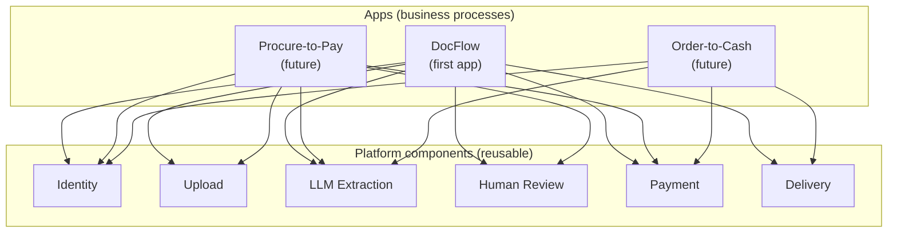
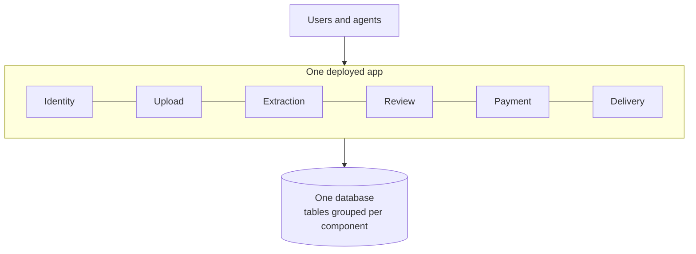
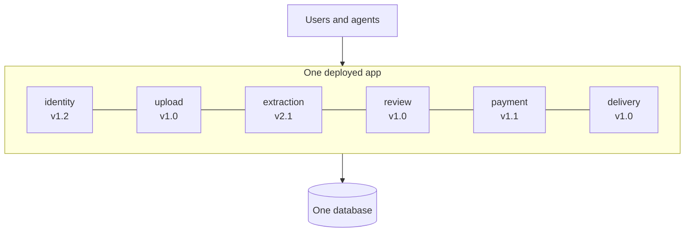
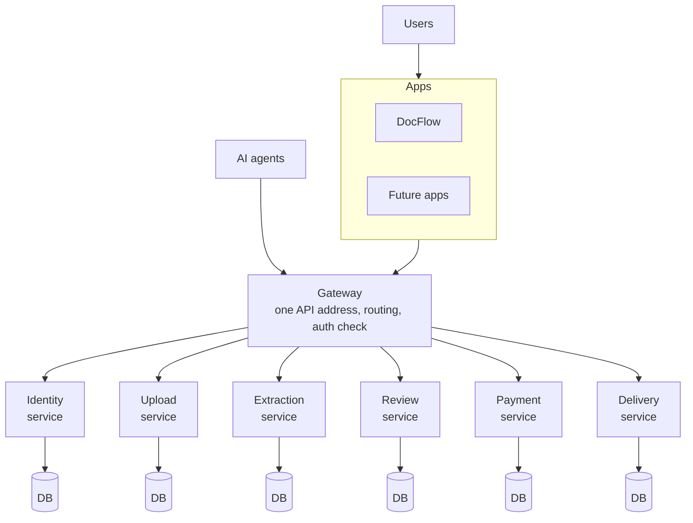
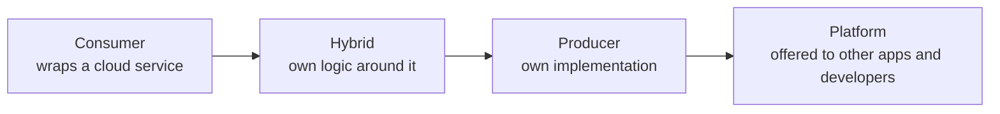

# Architecture — 01scale platform

| | |
|---|---|
| Owner | Nikhil Shrivastava |
| Status | Decided: distributed services (Option 3). Open points are listed in §10. |
| Related | `API-DESIGN.md`, `DATABASE-DESIGN.md`, `docs/prd/`, `docs/epics/` |

## 1. Summary

01scale is a set of **platform components** (identity, upload, extraction, review, payment, delivery). Each is released, demoed and marketed on its own, with a UI, an API and MCP tools for AI agents. **Apps** are built by combining components. DocFlow is the first app; Procure-to-Pay and Order-to-Cash are examples of later ones.

We compared three architectures and chose **distributed services**: each component is its own service with its own data, contract and release cycle. The reasons are product reasons (reuse across apps, independent evolution, independent release), not scale. §6 explains the choice and §7 states the cost we accepted.

## 2. What we are building

Two layers:

- **Platform components** do one job each and know nothing about the apps that use them.
- **Apps** are thin. An app is a business process: it calls components in an order that makes sense for that process. Procure-to-Pay would reuse Extraction to read supplier invoices; Order-to-Cash would reuse it to read purchase orders and remittances.

A drag-and-drop builder for assembling apps visually is future scope. Nothing here depends on it, and nothing here blocks it.

## 3. Requirements that drive the architecture

| # | Requirement | What it means in practice |
|---|---|---|
| R1 | **Reusable by many apps** | A component serves DocFlow today and other apps later, without being copied or forked. |
| R2 | **Each component evolves through versions, from consumer to producer** | It starts by wrapping an external cloud service and grows into providing that capability itself (§8). Apps must not break as it evolves. |
| R3 | **Independently releasable and marketable** | Each component ships on its own schedule with its own version, demo page, API reference and MCP tools. |
| R4 | **Usable by people, code and agents** | Every component has a UI, an API and MCP tools over the same operations. |
| R5 | **Different technology per component** | Extraction moves to Python and LangGraph on AWS Lambda; the rest is TypeScript. |
| R6 | **Isolation of sensitive components** | Identity and Payment hold the riskiest data and should be walled off from everything else. |
| R7 | **Demonstrates platform product leadership** | The portfolio should show how a real multi-product platform is structured and operated. |

Not a driver: traffic or team size. This is a one-person project with low traffic.

## 4. The three options

### Option 1 — One app with strict boundaries (modular monolith)

One application and one database. Each component is a folder with its own tables and a small public interface. An automated check fails any change where one component reaches into another's internals.

| Pros | Cons |
|---|---|
| Fastest route to a working DocFlow | One deployment: components cannot be released separately |
| Lowest cost: one hosting project, one database | One runtime: a Python component does not fit |
| Simple data consistency: one transaction can span components | A failure or bad deploy in one component affects all |
| One log, easy debugging | Two apps cannot run different versions of the same component |
| Boundaries can still be enforced by automated checks | Independence is a rule the team keeps, not a physical fact |

### Option 2 — Separate packages (one deployment)

Each component is its own versioned package inside the repository, with declared exports. The app installs the packages and is still deployed as one unit.

| Pros | Cons |
|---|---|
| Boundaries enforced by tooling: only exported items are reachable | Extra build and versioning work on every change |
| Each component has its own version and changelog | Still one deployment and one runtime |
| A package could be published for other developers to install | A failure in one component still affects all |
| Easy to lift a package into its own service later | A consumer gets a new version only by redeploying, so components are not truly released on their own |

### Option 3 — Separate services (distributed)

Each component is its own deployed service with its own database and its own published contract. Apps and agents reach the services through one gateway. Services never read each other's data.

| Pros | Cons |
|---|---|
| Each component is released, versioned and rolled back on its own | Slowest route to a working DocFlow |
| Many apps can use the same component, even on different versions | More to run: several deployments, databases and pipelines |
| A component can be rebuilt inside (Cognito → own identity) without consumers changing | No shared transaction: needs idempotency, retries and reconciliation |
| Each component can use the technology that fits it | A request crosses services: needs tracing to debug |
| A failure is contained to one component, if callers handle it | Network calls add latency and new failure modes |
| Sensitive components are isolated with their own data and access | Moving a boundary later is expensive, so boundaries must be right early |

## 5. Comparison

| | Option 1 | Option 2 | Option 3 |
|---|---|---|---|
| Common name | Modular monolith | Modular monolith with packages | Microservices |
| Deployments | 1 | 1 | 1 per component |
| Databases | 1 | 1 | 1 per component |
| Independent release (R3) | No | Version only | Yes |
| Reuse by separate apps (R1) | By sharing one app's code | By installing packages | By calling a service |
| Evolve without breaking apps (R2) | Possible, but all consumers move together | Possible, per redeploy | Yes, old and new versions can run side by side |
| Mixed technology (R5) | No | No | Yes |
| Isolation (R6) | Logical | Logical | Physical |
| Cost and effort | Lowest | Low to medium | Highest |
| Time to first working app | Shortest | Short | Longest |

## 6. Decision: Option 3, and why

### The reasoning

The deciding question was: **is 01scale one app, or a platform that many apps consume?**

If it were one app (DocFlow only), Option 1 would be the right answer, and most experienced architects would say so. But the goal is a platform:

1. **Components are products, apps are customers (R1, R3).** Identity or Extraction must stand alone: its own release, its own demo, its own documentation, its own version history. When Procure-to-Pay arrives, it should adopt Extraction by calling it, not by being built inside DocFlow's codebase. A service with a published contract is the natural unit for that.

2. **Each component has a long evolution ahead (R2).** Identity goes from wrapping Cognito to being an identity provider. Extraction goes from one model call to an orchestrated, guarded, cost-routed, judged pipeline. Across all of that, the contract seen by apps stays stable and the inside is replaced. A service boundary makes the inside invisible by construction, and lets version 1 and version 2 run at the same time so each app can move when it is ready.

3. **The components do not share one technology (R5).** Extraction becomes Python on AWS Lambda. That is a separate service no matter what the rest looks like, so the question becomes whether it is the exception or the pattern. Making it the pattern keeps one consistent way of building, securing and observing every component.

4. **Identity and Payment deserve hard walls (R6).** They hold credentials, sessions and payment records. Their own database and their own access rules reduce what any other component's bug can expose.

5. **It shows the work this portfolio is meant to show (R7).** Platform product leadership is largely about contracts between teams, versioning, backward compatibility, service ownership and the trade-offs of distribution. Those decisions only become real when the components are actually separate.

### Why Option 1 was not a good fit

Option 1 is a sound architecture, and it would have delivered DocFlow sooner and cheaper. It does not fit **these** requirements:

| Requirement | Where Option 1 falls short |
|---|---|
| R1 Reuse by many apps | A second app must either live inside the same deployment (then it is not a separate app) or copy the code (then it is not reuse). |
| R2 Evolution without breaking apps | Every consumer is compiled against the same copy, so all move to a new version at the same moment. Running "Identity on Cognito" and "Identity hand-built" side by side for a gradual migration is awkward. |
| R3 Independent release | There is one release. A fix to Delivery redeploys Identity and Payment too, and a rollback rolls everything back. |
| R5 Mixed technology | One runtime. The Python extraction pipeline cannot live in it. |
| R6 Isolation | One database credential can reach every table; isolation depends on discipline. |
| R7 Demonstration | It shows good judgment for a single product, but not the cross-service contracts and operations a platform role is about. |

### Why not Option 2

It improves boundaries but keeps one deployment and one runtime, so it misses R3, R5 and R6 in the same way Option 1 does. It remains useful inside the chosen design: shared code (the service template, the contract tooling) lives in packages.

## 7. The cost we accepted, and how we contain it

Choosing Option 3 without the usual scale or team-size pressure is a deliberate trade. Being explicit about it:

| Cost | How we contain it |
|---|---|
| More to build before the first app works | One **service template** (logging, tracing, errors, auth check, CI, deploy) built once with the first service and copied by the rest. |
| More to run and pay for | Serverless hosting that costs nothing when idle; the fewest moving parts that still keep services separate. |
| No transaction across services | Every write is idempotent; long processes are tracked step by step so a retry resumes; payments are reconciled from the payment provider's events. |
| Harder debugging | One request ID carried through every service, and one place to read traces. |
| Boundaries are expensive to move | Boundaries follow the product components already named in the PRD, and each contract is designed in its story before code is written. |
| Risk of a "distributed monolith" (services that must change together) | Services depend only on each other's published contract. A change that needs two services to deploy at once is treated as a design fault. |

**What would make us revisit:** if a boundary proves wrong (two services always change together), they are merged. Distribution is a tool for the requirements in §3, not a goal.

## 8. How each component evolves: from consumer to producer

Every component follows the same path: **start by consuming an external cloud service behind our own contract, then replace the inside with our own implementation, one version at a time.** Apps keep calling the same contract throughout.

### Identity

| Version | What changes inside | What it demonstrates |
|---|---|---|
| v1 | AWS Cognito managed login through standard OIDC | Integrating a managed identity service correctly |
| v2 | Own sessions and account management around Cognito | Owning the user record and session lifecycle |
| v3 | Hand-built passwordless: magic links, one-time codes | Token design, rate limiting, no account enumeration |
| v4 | Passkeys, recovery codes, re-authentication | Modern phishing-resistant authentication |
| v5 | Becomes an identity provider for other apps: OIDC provider (SSO), SCIM provisioning, organizations and roles | Being the producer, as companies like Okta are |

### LLM Extraction

| Version | What changes inside | What it demonstrates |
|---|---|---|
| v1 | One model call with a strict output schema | The simplest thing that works, with evals from day one |
| v2 | Orchestration: multi-step pipeline, fan-out per document, resume on failure | Running LLM work as a reliable process |
| v3 | Guardrails: schema validation, rule checks, source-quote verification, PII limits | Not trusting the model blindly |
| v4 | Cost-efficient model routing: cheapest model that passes, escalate on low confidence | Managing unit cost per document |
| v5 | Latency management: batching, caching, parallelism, time budgets | Meeting a response-time promise |
| v6 | Logs and observability: per-call tokens, cost, latency, traces and quality over time | Operating LLM features in production |
| v7 | LLM-as-judge: a second model checks the first, compared against human decisions | Measuring and raising trust in the output |

### The other components

| Component | Starts as (consumer) | Grows into (producer) |
|---|---|---|
| Upload | Presigned uploads to AWS S3 | Content checks, virus scanning, retention policies, resumable and batch uploads |
| Human Review | A review queue for flagged fields | Configurable review rules, assignment, service levels, corrections feeding evals |
| Payment | Stripe Checkout | Saved methods, one-tap pay, payment history, later metering and invoicing |
| Delivery | Email through Resend | A notification service: email, SMS, push, preferences, delivery log |

These ladders are the direction; the exact steps for each are decided in that component's PRD and stories.

### What stays fixed while the inside changes

- The **contract**: endpoints, request and response shapes, error codes, MCP tool names.
- **Versioning rules**: additive changes stay in the current version; a breaking change gets a new version, and the old one keeps running until its consumers have moved.
- **The evals** (for LLM components): the same test set must pass before and after an internal change.

## 9. Rules every service follows

| Rule | In plain terms |
|---|---|
| Owns its data | No service reads or writes another's database. |
| Publishes a contract | An OpenAPI description and matching MCP tools; consumers depend only on that. |
| One front door | Users and agents reach every service through the gateway at one address. |
| Verifies identity itself | Identity issues a signed token; each service checks it without calling Identity on every request. |
| Knows nothing about apps | A component never contains DocFlow-specific logic; that lives in the app. |
| Ships alone | Its own version, changelog, release and rollback. |
| Shows its work | Its own page on 01scale.com: try-it demo, API reference, MCP tools, spec and decisions. |
| Fails politely | Callers set timeouts and retry safely; one service being down degrades the app, it does not corrupt it. |

Apps (DocFlow first) call the components' APIs in a fixed order. Events between services are added when a second consumer needs them.

## 10. Open decisions

These are not settled and are needed before the first service is built.

| # | Question | Options |
|---|---|---|
| 1 | Repository layout | One repository holding all services, or one per service |
| 2 | Hosting | All on Vercel as separate projects, or a mix with AWS Lambda |
| 3 | Database isolation | A separate database per service, or one database project with a separate schema and credentials per service |
| 4 | Service-to-service communication | Plain HTTP first and events later, or events from the start |
| 5 | Existing stories | Regroup the 65 stories by service, or keep the epics and label each story with its service |
| 6 | Component names | Product names per component, or plain names for now |
| 7 | Budget | Free tiers only, or a small monthly cost |

## 11. What this changes in the existing plan

- `CLAUDE.md`, the PRDs and the epics currently describe a single Next.js app. They stay as they are until the questions in §10 are answered, then are updated in one change.
- The API design already written per story carries over: the endpoints keep their paths behind the gateway, and each belongs to one service.
- The database design carries over with one change: tables are grouped by owning service, and links between services become IDs, not foreign keys.
- The first slice is the Identity service, built complete (UI, API, MCP tools, demo page), together with the gateway and the service template.
