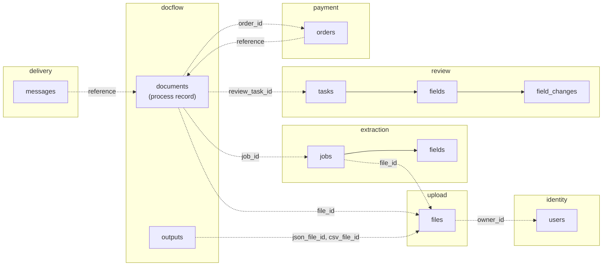

# Database design — 01scale

Neon Postgres, defined in Drizzle and changed only through migrations. **Each service owns its data**: one Neon project holds a separate schema and a separate database role per service, and a role can reach only its own schema. This file holds the rules every table follows and an index of all tables by owning service. The columns, constraints and indexes for each table are in the **Database design** section of the story that introduces or changes it, in `docs/epics/`.

**Status: design only.** A table is created by the migration in its story's PR, not before.

## Ownership rules

| Rule | In plain terms |
|---|---|
| One schema per service | `identity`, `upload`, `extraction`, `review`, `payment`, `delivery`, and `docflow` for the app. |
| One role per service | A service's database login cannot read or write any other schema. A test proves it. |
| No foreign keys across schemas | A record in another service is stored as a plain ID (for example `docflow.documents.file_id`). The link is checked through that service's API. |
| Copy, don't reach | When a service needs another's data to do its job, it receives a copy through an API call or an event (Review keeps its own copy of the fields it reviews). |
| No transaction across services | Each service commits on its own. Consistency comes from idempotent calls, the outbox for events, and retries. |
| Deleting a user | Identity announces `identity.user.deleted`; each service deletes or anonymizes its own rows for that user. |
| Splitting later | Because nothing crosses schemas, a service's schema can move to its own database without changing any other service. |

## Conventions

| Topic | Rule |
|---|---|
| Keys | `id uuid` primary key, UUIDv7 so IDs sort by creation time and are safe to expose in URLs. |
| Owner | Every user-owned table has `owner_id`: the user ID from the access token. The data-access layer always filters by it. |
| Names | `snake_case`, plural table names. |
| Time | `timestamptz`, always UTC. Every table has `created_at`. |
| Status | `text` with a `CHECK` constraint listing the allowed values (easier to migrate than Postgres enums). |
| Money | Integer minor units (`amount`) plus ISO 4217 `currency`. Never floats. |
| Secrets | Tokens, codes and API keys are stored only as hashes. Card numbers are never stored. |
| Idempotency | Uniqueness is enforced by the database (unique and partial unique indexes), not only by application code. |
| JSON | `jsonb` for extracted values and flexible metadata; anything queried or constrained gets its own column. |
| Audit | Each service's `audit_events` is append-only: its role cannot update or delete it. |
| Migrations | Per service, one per story, forward-only, tested against PGlite in that service's pipeline. |

## Tables by owning service

| Schema | Table | Purpose | Introduced in |
|---|---|---|---|
| every service | `audit_events` | Append-only record of important events in that service. | `MVP1-E0-02` |
| every service | `idempotency_keys` | Saved responses for retried POSTs. | `MVP1-E0-05` |
| every service | `outbound_events` | Events waiting to be delivered to subscribers (outbox). | `MVP1-E0-07` |
| identity | `users` | One row per person. | `MVP1-E1-02` |
| identity | `sessions` | Browser sessions; only a hash of the token is stored. | `MVP1-E1-03` |
| identity | `signing_keys` | Keys that sign access tokens. | `MVP1-E1-03` |
| identity | `api_keys` | Keys for agents and scripts; hash only. | `MVP1-E0-06` |
| identity | `service_clients` | Services and apps allowed to get tokens, and what they may do for users; secret hash only. | `MVP1-E1-03` |
| identity | `auth_identities` | How a user can sign in (email, passkey). | `MVP2-E8-01` |
| identity | `login_tokens` | Magic links and one-time codes; hash only. | `MVP2-E8-01` |
| identity | `passkeys` | WebAuthn credentials. | `MVP2-E8-01` |
| identity | `recovery_codes` | Single-use recovery codes; argon2 hashes. | `MVP2-E8-01` |
| identity | `rate_limits` | Counters for per-email and per-IP limits. | `MVP2-E8-02` |
| identity | `webauthn_challenges` | Short-lived passkey challenges. | `MVP2-E8-04` |
| identity | `email_changes` | Pending email address changes. | `MVP2-E8-07` |
| upload | `files` | A stored file with its checks and status. | `MVP1-E2-02` |
| extraction | `jobs` | One extraction attempt, with model, cost and timing. | `MVP1-E3-01` |
| extraction | `fields` | The model's output: value, confidence and evidence. Never edited. | `MVP1-E3-02` |
| extraction | `page_texts` | Each page's text (text layer or OCR), for the quote check. | `MVP1-E3-03` |
| extraction | `job_groups` | Jobs run together with a concurrency limit. | `MVP2-E9-02` |
| extraction | `pipeline_runs` | Per-node checkpoints so a retry resumes. | `MVP2-E9-02` |
| extraction | `field_judgements` | The judge model's verdict on a field. | `MVP2-E10-01` |
| extraction | `enrichments` | Web-sourced vendor metadata with citations. | `MVP2-E11-01` |
| review | `tasks` | One review of a set of fields. | `MVP1-E4-01` |
| review | `fields` | Review's own copy of each field, with the human's final value. | `MVP1-E4-01` |
| review | `field_changes` | History of every change to a field. | `MVP1-E4-02` |
| review | `eval_candidates` | Human corrections waiting to become eval cases. | `MVP1-E4-04` |
| review | `chat_messages` | Correction chat history. | `MVP2-E11-03` |
| review | `field_proposals` | Changes proposed by the chat agent. | `MVP2-E11-03` |
| payment | `orders` | A one-time payment through Stripe Checkout. | `MVP1-E6-01` |
| payment | `stripe_events` | Processed webhook event IDs. | `MVP1-E6-02` |
| payment | `customers` | The Stripe customer for a user. | `MVP2-E13-01` |
| payment | `payment_methods` | Saved cards (brand, last 4, expiry only). | `MVP2-E13-02` |
| payment | `payments` | Payments with a saved card (PaymentIntents). | `MVP2-E13-04` |
| delivery | `messages` | Email sends and their status. | `MVP1-E7-03` |
| delivery | `notification_preferences` | Per-user channel and event settings. | `MVP2-E14-01` |
| delivery | `push_subscriptions` | Web push devices. | `MVP2-E14-03` |
| delivery | `notifications` | Every notification attempt per channel. | `MVP2-E14-04` |
| docflow | `documents` | The process record: IDs of the file, job, review task and order for one invoice. | `MVP1-E0-09` |
| docflow | `inbound_events` | Processed service event IDs. | `MVP1-E0-09` |
| docflow | `batches` | A group of documents processed together. | `MVP2-E9-01` |

## How records link across services

Solid arrows are foreign keys inside one schema. Dotted arrows are plain IDs that point at another service's record.
