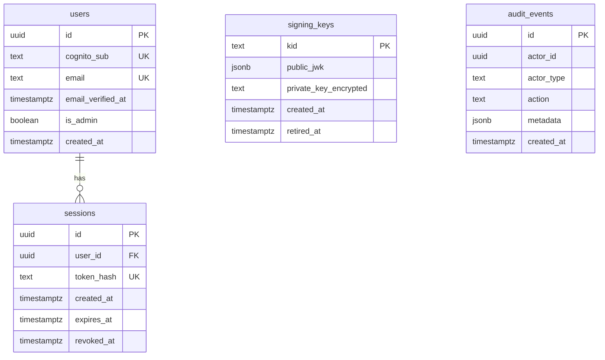

# Identity service — data model

> **Version 1 · Login with AWS Cognito.** Status: designed, not built. Stories: `MVP1-E1-01`, `MVP1-E1-02`, `MVP1-E1-03`, `MVP1-E1-04`, `MVP1-E1-06`.

Only the tables login uses, all in the `identity` schema. No other service can read them; other services refer to a user by `id` only. Shared database rules are in [`docs/architecture/DATABASE-DESIGN.md`](../../architecture/DATABASE-DESIGN.md).

## Diagram

## `identity.users`

One row per person. Created the first time someone completes sign-in with a verified email.

**Fields**

| Field | Type | Empty allowed | Default | Constraints | What it means |
|---|---|---|---|---|---|
| `id` | `uuid` | No | generated (UUIDv7) | Primary key | The user's ID everywhere in 01scale. Other services store it as `owner_id`. Never changes. |
| `cognito_sub` | `text` | No |  | Unique. 1 to 255 characters | Cognito's permanent ID for this person (the `sub` claim). Used to find the user at sign-in. Not the email, because an email can change. |
| `email` | `text` | No |  | Unique ignoring case. Stored lower-cased. 3 to 320 characters and contains `@` | The verified email address from Cognito. Shown in the UI and used by Delivery to send email. |
| `email_verified_at` | `timestamptz` | No |  |  | When Identity first saw this email as verified. Always set, because unverified emails are refused. |
| `is_admin` | `boolean` | No | false |  | Allows admin-only pages and endpoints. Set by hand in the database; there is no API to change it. |
| `created_at` | `timestamptz` | No | now() |  | When the user first signed in. Shown as 'joined'. |

**Constraints and indexes**

- `users_pkey`: primary key (`id`)
- `users_cognito_sub_key`: unique (`cognito_sub`)
- `users_email_lower_key`: unique index on `lower(email)`
- `users_email_format_check`: `email = lower(email)` and `email like '%_@_%'` and `length(email) between 3 and 320`

**Sample data**

| `id` | `cognito_sub` | `email` | `email_verified_at` | `is_admin` | `created_at` |
|---|---|---|---|---|---|
| `0193a5b2-7c1e-7a3f-9b2d-4e6f8a1c2d3e` | `a1b2c3d4-5e6f-7081-92a3-b4c5d6e7f809` | `priya@example.com` | `2026-11-16 09:14:07+00` | `false` | `2026-11-16 09:14:07+00` |
| `0193a5c9-11aa-7d42-8f10-2b7c9d0e1f2a` | `0f9e8d7c-6b5a-4938-2716-0a1b2c3d4e5f` | `owner@example.com` | `2026-11-16 10:02:41+00` | `true` | `2026-11-16 10:02:41+00` |

## `identity.sessions`

One row per browser sign-in. A request is signed in if its cookie matches a row that is neither revoked nor expired.

**Fields**

| Field | Type | Empty allowed | Default | Constraints | What it means |
|---|---|---|---|---|---|
| `id` | `uuid` | No | generated (UUIDv7) | Primary key | The session's ID. Appears in access tokens as `sid` and in audit events. |
| `user_id` | `uuid` | No |  | Foreign key to `identity.users(id)`, delete cascades | Whose session this is. |
| `token_hash` | `text` | No |  | Unique. Exactly 64 lower-case hex characters | SHA-256 of the cookie's token. The token itself is never stored, so a database leak cannot be used to sign in. |
| `created_at` | `timestamptz` | No | now() |  | When the user signed in. |
| `expires_at` | `timestamptz` | No |  | Later than `created_at` | When the session stops working: 7 days after `created_at`. |
| `revoked_at` | `timestamptz` | Yes |  | Not earlier than `created_at` | Set when the user signs out or their sessions are revoked after a password reset. Empty means still active. |

**Constraints and indexes**

- `sessions_pkey`: primary key (`id`)
- `sessions_user_id_fkey`: foreign key (`user_id`) references `identity.users(id)` on delete cascade
- `sessions_token_hash_key`: unique (`token_hash`)
- `sessions_token_hash_check`: `token_hash ~ '^[0-9a-f]{64}$'`
- `sessions_expiry_check`: `expires_at > created_at`
- `sessions_revoked_check`: `revoked_at is null or revoked_at >= created_at`
- `sessions_user_id_idx`: index on (`user_id`, `created_at` desc)

**Sample data**

| `id` | `user_id` | `token_hash` | `created_at` | `expires_at` | `revoked_at` |
|---|---|---|---|---|---|
| `0193a5b2-9d40-7c11-a6e3-5f1b2c3d4e5f` | `0193a5b2-7c1e-7a3f-9b2d-4e6f8a1c2d3e` | `9f2c1e7ab4d08c35e6f1a2b3c4d5e6f708192a3b4c5d6e7f8091a2b3c4d5e6f7` | `2026-11-16 09:14:07+00` | `2026-11-23 09:14:07+00` | (empty) |
| `0193a61f-03b7-7e90-b1c4-6a7b8c9d0e1f` | `0193a5b2-7c1e-7a3f-9b2d-4e6f8a1c2d3e` | `1b7d4e90c2a5f8361d0e9c8b7a6f5e4d3c2b1a09f8e7d6c5b4a3928170615243` | `2026-11-10 18:30:00+00` | `2026-11-17 18:30:00+00` | `2026-11-12 08:05:19+00` |

## `identity.signing_keys`

The keys that sign access tokens. Usually one row; two for a few minutes during a rotation.

**Fields**

| Field | Type | Empty allowed | Default | Constraints | What it means |
|---|---|---|---|---|---|
| `kid` | `text` | No |  | Primary key. 1 to 64 characters | The key's name, for example `k2026-11`. Written into every token so a service knows which public key to use. |
| `public_jwk` | `jsonb` | No |  | Must contain `kty`, `crv`, `x`, `y` and must not contain `d` | The public half, in the format served by `GET /jwks`. |
| `private_key_encrypted` | `text` | No |  |  | The private half, encrypted with a key held only in the service's environment. Never leaves the service. |
| `created_at` | `timestamptz` | No | now() |  | When the key was created. |
| `retired_at` | `timestamptz` | Yes |  | Not earlier than `created_at` | When the key stopped signing new tokens. Empty means it is the active key. |

**Constraints and indexes**

- `signing_keys_pkey`: primary key (`kid`)
- `signing_keys_public_only_check`: `public_jwk ?& array['kty','crv','x','y']` and not `public_jwk ? 'd'`
- `signing_keys_one_active_idx`: unique index on (`(true)`) where `retired_at is null`, so only one key can be active
- `signing_keys_retired_check`: `retired_at is null or retired_at >= created_at`

**Sample data**

| `kid` | `public_jwk` | `private_key_encrypted` | `created_at` | `retired_at` |
|---|---|---|---|---|
| `k2026-11` | `{"kty":"EC","crv":"P-256","x":"f83OJ3D2…","y":"x_FEzRu9…"}` | `v1:AES-GCM:9c1f…(encrypted)` | `2026-11-01 00:00:00+00` | (empty) |

## `identity.audit_events`

An append-only record of what happened. Every service has this table from the service template; these are the events login writes.

**Fields**

| Field | Type | Empty allowed | Default | Constraints | What it means |
|---|---|---|---|---|---|
| `id` | `uuid` | No | generated (UUIDv7) | Primary key | The event's ID. |
| `actor_id` | `uuid` | Yes |  |  | The user who acted. Empty when sign-in failed before a user was known. |
| `actor_type` | `text` | No |  | One of `user`, `api_key`, `service`, `system` | What kind of caller acted. |
| `action` | `text` | No |  | For login: `auth.signup`, `auth.signin`, `auth.signout`, `auth.signin_failed`, `auth.sessions_revoked` | What happened. |
| `target_type` | `text` | Yes |  |  | The kind of thing acted on, for example `session`. |
| `target_id` | `uuid` | Yes |  |  | Its ID. |
| `metadata` | `jsonb` | No | '{}' | Allow-listed keys only: `reason`, `mode`, `count`. Never tokens, codes, passwords or email addresses | Small extra facts about the event. |
| `request_id` | `text` | Yes |  |  | The request that caused it, to trace across services. |
| `created_at` | `timestamptz` | No | now() |  | When it happened. |

**Constraints and indexes**

- `audit_events_pkey`: primary key (`id`)
- `audit_events_actor_type_check`: `actor_type in ('user','api_key','service','system')`
- The service's database login has `INSERT` and `SELECT` only on this table: no `UPDATE`, no `DELETE`
- `audit_events_actor_idx`: index on (`actor_id`, `created_at` desc)

**Sample data**

| `id` | `actor_id` | `actor_type` | `action` | `target_type` | `target_id` | `metadata` | `created_at` |
|---|---|---|---|---|---|---|---|
| `0193a5b2-9d41-7f02-8c55-0a1b2c3d4e5f` | `0193a5b2-7c1e-7a3f-9b2d-4e6f8a1c2d3e` | `user` | `auth.signup` | `user` | `0193a5b2-7c1e-7a3f-9b2d-4e6f8a1c2d3e` | `{}` | `2026-11-16 09:14:07+00` |
| `0193a5b2-9d42-7a6b-9d77-1b2c3d4e5f6a` | `0193a5b2-7c1e-7a3f-9b2d-4e6f8a1c2d3e` | `user` | `auth.signin` | `session` | `0193a5b2-9d40-7c11-a6e3-5f1b2c3d4e5f` | `{"mode":"signup"}` | `2026-11-16 09:14:07+00` |
| `0193a7d0-4410-7b3c-8e21-2c3d4e5f6a7b` | (empty) | `system` | `auth.signin_failed` | (empty) | (empty) | `{"reason":"login_state_mismatch"}` | `2026-11-16 11:40:52+00` |

## Other tables in this schema

The service template also gives Identity `idempotency_keys` and `outbound_events`. Login does not use them: its endpoints are redirects and reads, and the only event Identity announces (`identity.user.deleted`) belongs to Account management.

## Constraints at the schema level: enforced by the database, whatever the code does

- Primary keys on every table; `cognito_sub`, `lower(email)` and `token_hash` are unique.
- A session cannot exist without its user (foreign key), and is deleted with the user.
- `token_hash` must be 64 hex characters; `expires_at` must be after `created_at`.
- `email` must be lower-case, contain `@`, and be 3 to 320 characters.
- Only one signing key can be active; a stored public key can never contain private material.
- Audit events can be added and read but never changed or deleted.
- Identity's database login can reach only the `identity` schema. No other service can read these tables.

## Constraints at the data model level: business rules the service guarantees

- A user exists only for a verified email. Unverified sign-ins create nothing.
- One person is one user: matched by Cognito's permanent ID, never by email alone.
- A session is valid only if it is not revoked and not past `expires_at`. Both are checked on every use.
- Session lifetime is 7 days and is not extended by use (sliding expiry arrives in version 2).
- Access tokens live 5 minutes and are never stored. Signing out stops new tokens at once; an already-issued token works for at most 5 more minutes.
- Only hashes of session tokens are stored. Cognito's tokens and the user's password are never stored at all.
- After a password reset, all of that user's older sessions are revoked at the next sign-in.
- Unknown, expired and revoked sessions all get the same `401`, so an attacker learns nothing.
- Every sign-up, sign-in, sign-out and failed sign-in writes an audit event in the same transaction as the change.

## What is deliberately not stored

- Passwords: they live only in Cognito.
- Cognito's ID, access and refresh tokens: used once at the callback and discarded.
- The session token itself: only its hash.
- Access tokens: they are verified by signature, never looked up.
