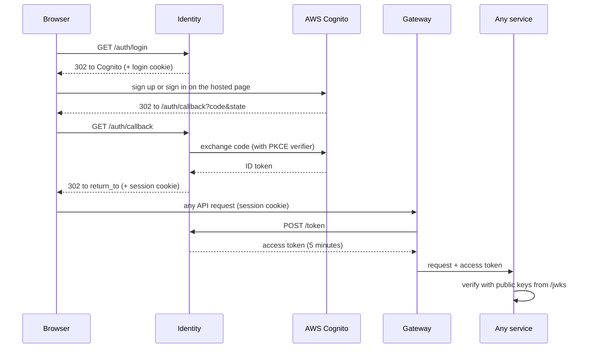

# Identity service — developer guide

> **Version 1 · Login with AWS Cognito.** Status: designed, not built. Stories: `MVP1-E1-01`, `MVP1-E1-02`, `MVP1-E1-03`, `MVP1-E1-04`, `MVP1-E1-06`.

This guide covers **login only**, as it works in version 1 with AWS Cognito. The other documents for this service: [user journeys](USER-JOURNEYS.md), [UI components](UI-COMPONENTS.md), [API specification](API-SPEC.md), [data model](DATA-MODEL.md), [schema](SCHEMA.md), and the [AWS setup](../../infra/cognito.md). The same content is on the site at `/products/login-using-aws/readme`.

## What this service is

Identity is the platform service that answers one question for every other service and app: who is making this request?

In version 1 it does not store passwords or show a login form itself. It sends the user to AWS Cognito's hosted sign-in page, and when Cognito sends them back it creates a 01scale user and a 01scale session.

It then issues short-lived access tokens that every other service can verify on its own, so no other service ever handles a password, a cookie or a Cognito token.

## Why it exists

| Reason | In plain terms |
|---|---|
| One place for sign-in | Upload, Extraction, Review, Payment and Delivery must not each build login. They trust one token from Identity. |
| Passwords are not our problem yet | Cognito handles sign-up, email verification, password rules and password reset. Version 1 consumes that instead of rebuilding it. |
| The provider can be replaced | Cognito is used only through the open standard OIDC. Version 2 swaps in hand-built passwordless login behind the same endpoints, and no app or service changes. |
| Apps stay simple | An app needs one link to sign a user in and one call to learn who they are. |

## What is in this version

**In scope**

- Sign up with email and password, with the email verified by a code (on Cognito's page)
- Sign in and sign out
- Forgot and reset password (on Cognito's page)
- A 01scale session kept in a secure cookie
- Short-lived access tokens for the other services, and the public keys to verify them
- An audit record of every sign-up, sign-in, sign-out and failed sign-in

**Not in this guide**

- Account page, change password from the account page, delete account (the Account management module)
- API keys for AI agents (story MVP1-E0-06)
- A branded sign-in page at auth.01scale.com (pending story MVP1-E1-07)
- Sign in with Google (pending story MVP1-E1-08)
- Two-step verification
- Magic links, passkeys and anything else from version 2

## How login works



| Step | Who | What happens |
|---|---|---|
| 1 | Browser | The user taps Sign in. The app sends them to `GET /auth/login`. |
| 2 | Identity | Creates three one-time values (`state`, `nonce` and a PKCE code verifier), keeps them in a 10-minute encrypted cookie, and redirects the browser to Cognito. |
| 3 | Cognito | Shows the hosted page. The user signs up (and verifies their email with a code) or signs in. Cognito redirects back with a one-time `code`. |
| 4 | Identity | On `GET /auth/callback`: checks `state`, exchanges the `code` for Cognito tokens using the code verifier, checks the ID token (`nonce`, issuer, audience, expiry) and requires a verified email. |
| 5 | Identity | Finds the user by Cognito's user ID or creates one, creates a session, sets the session cookie, writes an audit event and redirects to the page the user asked for. |
| 6 | Gateway | On every later API request, exchanges the session cookie for a 5-minute access token (`POST /token`) and forwards the request with it. |
| 7 | Any service | Verifies the access token's signature with Identity's public keys (`GET /jwks`) and reads the user ID from it. No call to Identity is needed. |

## Words used in this guide

| Term | Meaning |
|---|---|
| User | A person, identified inside 01scale by a `user.id`. Cognito's ID for the same person is stored as `cognito_sub`. |
| Session | Proof that a browser signed in. The browser holds a random token in a cookie; Identity stores only a hash of it. Lasts 7 days. |
| Access token | A signed pass valid for 5 minutes that says which user is calling. Services verify it themselves. Browsers never see it. |
| Signing key | The private key Identity signs access tokens with. The matching public key is published so services can verify. |
| OIDC | OpenID Connect: the open standard for 'sign in with a provider'. Identity uses its authorization code flow. |
| PKCE | An extra one-time secret in that flow, so a stolen `code` cannot be exchanged by anyone else. |
| state and nonce | Two one-time values that prove the response from Cognito belongs to the login this browser started. |

## Quick start

These examples work once the service is built and deployed behind the gateway.

### 1. Send the user to sign in

Use a plain link. Set `return_to` to the page they should land on.

```html
<a href="/api/identity/v1/auth/login?mode=signin&return_to=/documents">Sign in</a>
<a href="/api/identity/v1/auth/login?mode=signup&return_to=/documents">Create account</a>
```

### 2. Find out who is signed in

From the browser, the cookie is sent automatically. A `401` means nobody is signed in.

```ts
const res = await fetch("/api/identity/v1/session");
if (res.status === 401) {
  // show the Sign in link
} else {
  const { user } = await res.json();
  console.log(user.email); // "priya@example.com"
}
```

### 3. Trust the caller inside a service

The gateway has already attached an access token. Verify it with Identity's public keys; do not call Identity.

```ts
import { createRemoteJWKSet, jwtVerify } from "jose";

const keys = createRemoteJWKSet(
  new URL("https://01scale.com/api/identity/v1/jwks"),
);

export async function requireUser(request: Request) {
  const token = request.headers.get("authorization")?.replace("Bearer ", "");
  if (!token) throw new Response(null, { status: 401 });
  const { payload } = await jwtVerify(token, keys, {
    issuer: "https://01scale.com/api/identity/v1",
    audience: "01scale",
  });
  return { userId: payload.sub as string, isAdmin: payload.is_admin === true };
}
```

### 4. Sign out

End the 01scale session, then follow `logout_url` so Cognito's session ends too.

```ts
const res = await fetch("/api/identity/v1/auth/logout", { method: "POST" });
const { logout_url } = await res.json();
window.location.href = logout_url;
```

## Endpoints at a glance

Base address: `https://01scale.com/api/identity/v1`

| Method | Path | Access | Purpose |
|---|---|---|---|
| `GET` | `/auth/login` | Public | Start sign-in or sign-up |
| `GET` | `/auth/callback` | Public | Finish sign-in |
| `GET` | `/session` | Signed in | Who am I |
| `POST` | `/auth/logout` | Signed in | Sign out |
| `POST` | `/token` | Service | Exchange a session for an access token |
| `GET` | `/jwks` | Public | Public keys |

## Configuration

Set as environment variables on the Identity service's own Vercel project. Secrets are never committed.

| Variable | Value | Secret |
|---|---|---|
| `COGNITO_ISSUER` | `https://cognito-idp.us-east-1.amazonaws.com/<user pool ID>` | No |
| `COGNITO_DOMAIN` | `https://<prefix>.auth.us-east-1.amazoncognito.com` | No |
| `COGNITO_CLIENT_ID` | The app client's ID | No |
| `COGNITO_CLIENT_SECRET` | The app client's secret | Yes |
| `APP_BASE_URL` | `https://01scale.com` | No |
| `IDENTITY_DATABASE_URL` | Neon connection string for the `identity` role | Yes |
| `LOGIN_COOKIE_KEY` | 32 random bytes, base64: encrypts the login cookie | Yes |
| `SIGNING_KEY_ENCRYPTION_KEY` | 32 random bytes, base64: encrypts stored private keys | Yes |
| `GATEWAY_SERVICE_KEY` | 32 random bytes, base64: shared with the gateway only | Yes |

## Decisions

| Question | What I decided |
|---|---|
| Failed sign-in in a browser | A browser is sent to a friendly page that explains the problem and offers one button to start again. Apps and AI agents still get the error with its code. |
| Session length | 7 days from sign-in, not extended by use. |
| Several ways to sign in for one person | Version 1 keeps one Cognito ID on the user. A separate table of logins arrives with Sign in with Google (`MVP1-E1-08`), which moves the data then. |
| An email longer than 254 characters | Sign-in checks it before saving and returns the error `email_not_supported`, instead of failing on the database's own check. |

## Open questions

- Rate limit numbers are starting values to be tuned once there is real traffic.
